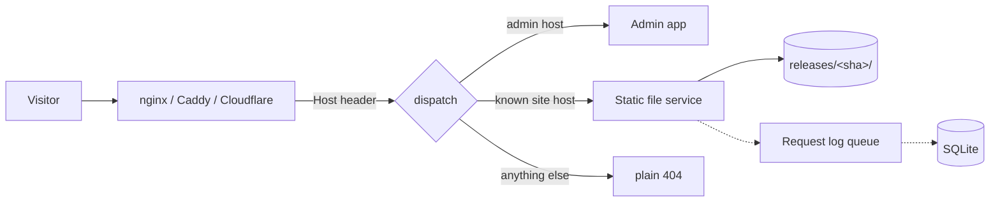
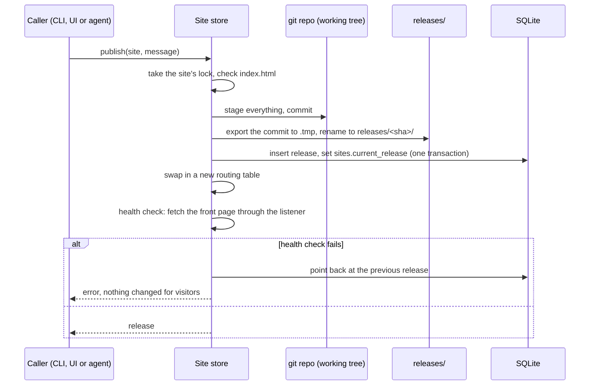
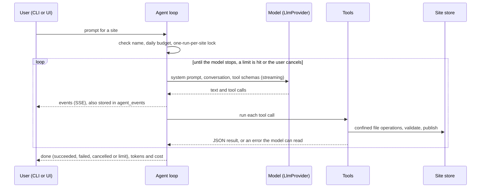

# Architecture

One daemon process does everything: it serves the sites, hosts the admin UI and API, runs
the agent, collects metrics and updates itself. This page describes what exists today and
grows with each milestone; [PLAN.md](../PLAN.md) describes the full v1 design.

## Crates

| Crate | Role |
| --- | --- |
| `sitewright` | The binary: CLI, daemon start-up and shutdown, admin-socket client. |
| `sw-core` | Configuration, data-directory layout, validated names, database pool and migrations. |
| `sw-sites` | The site store: path confinement, git history, immutable releases, routing table. |
| `sw-web` | HTTP: host-based dispatch, static serving, the JSON API, the admin socket, and the admin UI with its authentication. |
| `sw-metrics` | Request log and privacy-preserving visitor hashing. |
| `sw-llm` | The `LlmProvider` trait, SSE parsing, retries and the provider adapters. |
| `sw-agent` | The agent loop, its tools, the system prompt and run persistence. |
| `sw-tls`, `sw-update` | Placeholders for later milestones. |

Dependencies point one way: `sitewright` → `sw-web` → `sw-agent` → `sw-sites`, `sw-llm` →
`sw-core`.

## A request



`dispatch` normalizes the `Host` header (lowercase, no port) and looks it up in an
in-memory routing table that maps hostnames to release directories. The table is an
immutable snapshot behind an atomic pointer, rebuilt from the database whenever a site
changes, so lookups never take a lock and never see a half-applied change.

Site responses carry `X-Content-Type-Options: nosniff`, a `Referrer-Policy` and
`Content-Security-Policy: frame-ancestors 'self'`. HTML is served with
`Cache-Control: no-cache` (always revalidated); other files may be reused for five minutes.

## A publish



Three properties follow from this shape:

- **A release is immutable and complete.** It is exported from the git commit, not copied
  from the working tree, and renamed into place only once it is fully written.
- **Going live is one pointer switch.** Rollback is the same switch in the other direction,
  which is why it is instant. Rolling back also resets the working tree to the release's
  content, without moving git's `HEAD`, so the next publish records the change on top of
  the existing history.
- **Edits are never live until published.** File tools write to the working tree only.

## An agent run



The model never touches the disk or the network. Tool implementations are ordinary Rust
that call the site store, so the sandbox, validation and health-check rules above apply
to the agent exactly as they do to the CLI. Tool failures are returned to the model as
results, not raised, so it can correct itself; only provider failures end a run. Deleting
a site is never done by a tool: `delete_site` emits a confirmation request that a person
answers by typing the site's name.

## The admin UI

Server-rendered pages (`web/templates`, compiled into the binary by askama) with htmx for
form posts and a little hand-written JavaScript for passkeys and the live run view. All
assets are embedded (`web/static`); there is no build step and no CDN.

Every request to the admin hostname passes one guard (`sw_web::admin::guard`):

1. A state-changing request whose `Origin` is not the admin origin is refused.
2. With a session cookie: state-changing requests must carry the session's CSRF token.
3. Without one: public paths (sign-in, enrollment, static files) pass; `/api/*` accepts an
   API token; everything else redirects to the sign-in page or answers 401.

Authentication is passkeys only. `sitewright admin invite` creates a one-time enrollment
link over the admin socket; the same command is the recovery path. See
[security.md](security.md).

## The file sandbox

Every path that comes from outside (the API, an imported archive, later the agent) goes
through `sw_sites::confine` before it touches the disk. Paths must be relative, use only
ordinary characters, have an allowed extension and contain no hidden components (which
rules out `.git`). Existing path components are checked with `lstat` and symlinks are
refused. Exporting a release writes regular files only.

## The admin socket

`sitewright site …` commands send JSON over a Unix socket at `<data>/admin.sock`
(mode 0600, inside the 0700 data directory). The CLI never opens the database itself, so
there is exactly one writer. Whoever can open the socket can administer the daemon: shell
access to the server is the root of trust.

## Data directory

```text
<data>/
  config.toml            # optional; see configuration.md
  admin.sock             # CLI <-> daemon
  db/sitewright.db       # SQLite, WAL mode
  sites/<name>/repo/     # git working tree: the site's source
  sites/<name>/releases/<sha>/   # immutable published copies
  backups/               # database copy taken before each migration
```
